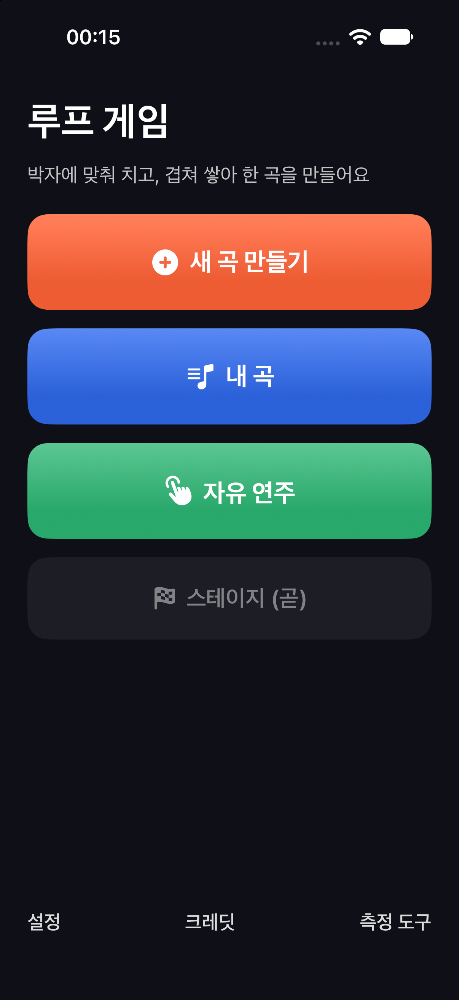
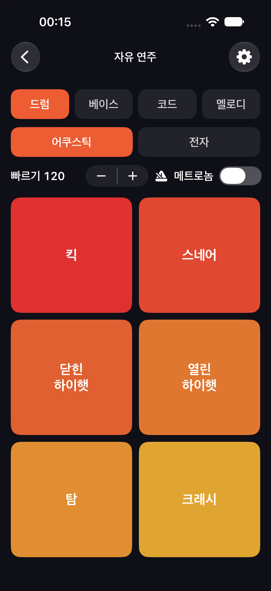
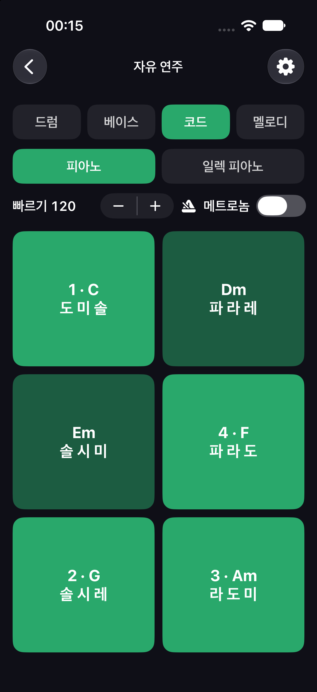

# LoopGame

음악을 한 번도 배워 본 적 없는 사람도 박자에 맞춰 악기를 치고, 여러 악기를 겹쳐 쌓아 한 곡을 완성할 수 있는 iOS 게임입니다. 아이폰과 아이패드에서 돌아가고, Swift로 만들었습니다.

<p>
  
  
  
</p>

## 어떤 게임인가

- **패드 악기로 연주합니다.** 드럼은 킷 패드로 칩니다. 베이스와 멜로디 패드에는 그 곡의 음계에 속한 음만 올라가 있어서 틀린 음을 칠 수 없습니다. 코드는 패드 하나에 코드 하나입니다(예: 1·C = 도 미 솔). 설정에서 건반 모드로 바꿀 수도 있습니다.
- **루프 스테이션으로 쌓습니다.** 1·2·4·8마디 루프를 녹음해서 최대 8트랙까지 겹칩니다.
- **AI가 살짝 고쳐 줍니다.** 녹음이 끝나면 박자가 밀리거나 어색한 음을 고친 버전을 1~2개 제안합니다. 원래 연주와 들어 보고 하나를 고르면 됩니다. AI는 기기 안에서만 돌아가고 인터넷이 필요 없습니다.
- **곡이 자동으로 짜입니다.** 만든 루프들로 인트로 → 본론 → 아웃트로가 있는 1분 이상의 곡이 자동으로 구성됩니다. 마음에 안 드는 구간만 고치면 됩니다.
- **스테이지 18개로 배웁니다.** 메트로놈 따라 치기부터 드럼, 베이스, 코드, 멜로디를 거쳐 곡 완성까지, 각 스테이지는 "따라 치기 → 직접 만들기" 순서로 진행됩니다. 자유 연주는 처음부터 열려 있습니다.

## 진행 상황

| 단계 | 내용 | 상태 |
|---|---|---|
| Phase 0 | 프로젝트 골격(XcodeGen + Swift 패키지) | 완료 |
| Phase 1 | 시험 제작: 오디오 엔진, AI 보정 | 완료 — 실기기 측정 통과 |
| Phase 2 | 핵심 로직: 곡 모델, 판정, 자동 구성, 스테이지 데이터 | 완료 |
| Phase 3 | 앱 화면: 자유 연주, 루프 녹음, AI 비교, 저장·내보내기 | **진행 중** |
| Phase 4 | 스테이지 화면 | 예정 |
| Phase 5 | 공유 갤러리·랭킹(CloudKit), 출시 준비 | 출시 직전에 결정 |

### 실기기 측정 결과 (Phase 1)

| 항목 | iPhone 15 Pro | iPad Air 5 |
|---|---|---|
| 앱 처리 지연 P95(터치가 앱에 도착 → 소리를 오디오 장치에 넘김) | 7.79 ms | 7.56 ms |
| 터치 → 스피커 전체 지연 P95 | 50.3 ms | 29.6 ms |
| 8트랙 60초 재생 CPU | 11.8 % | 4.0 % |
| 끊김 | 0 | 0 |

전체 지연의 대부분은 iOS 자체 몫(터치 처리, 스피커 출력)입니다. 리듬 판정은 첫 스테이지에서 사용자별 지연을 재서 보정합니다.

## 빌드하기

필요한 것: macOS, Xcode 27 이상, [XcodeGen](https://github.com/yonaskolb/XcodeGen)

```sh
brew install xcodegen
git clone https://github.com/Shin-junyeob/LoopGame.git
cd LoopGame
xcodegen generate
open LoopGame.xcodeproj
```

- `project.yml`의 `DEVELOPMENT_TEAM`과 `PRODUCT_BUNDLE_IDENTIFIER`는 원작자의 값입니다. 직접 빌드하려면 본인 Apple ID의 팀과 고유한 번들 ID로 바꾸세요. 무료 Apple ID(Personal Team)로도 내 기기에 설치할 수 있습니다(7일마다 다시 설치).
- 실기기에서는 설정 → 개인정보 보호 및 보안 → 개발자 모드를 켜야 합니다.
- Xcode 프로젝트는 `xcodegen generate`로 매번 새로 만들기 때문에 저장소에 들어 있지 않습니다.

### 테스트

화면을 제외한 핵심 로직은 `LoopCore` Swift 패키지에 있고, Xcode 없이도 테스트할 수 있습니다.

```sh
cd LoopCore && swift test
```

## 구조

```
App/          SwiftUI 앱 — 화면, 오디오 엔진 연결(AVAudioEngine), 패드 입력(UIKit 터치)
LoopCore/     플랫폼과 무관한 로직(Swift 패키지)
  Clock       박자 ↔ 샘플 위치 정수 계산(10분 재생해도 박자 밀림 0)
  Renderer    메모리 할당 없는 실시간 믹서
  Song        곡 데이터(JSON, schemaVersion)
  Timing      따라 치기 판정(Perfect ≤ 50 ms, Good ≤ 100 ms)
  Arranger    인트로·본론·아웃트로 자동 구성
  Corrector   AI 보정(n-gram 모델 + 음계·코드 제약)
  Stages      스테이지 18개와 과제 판정
tools/train/  AI 모델 학습 스크립트(Python, uv)
data/corpus/  학습 데이터
```

### AI 보정에 대해

보정 AI는 역할(드럼·베이스·코드·멜로디)별 n-gram 통계 모델입니다. 음계와 코드에 맞는 범위 안에서 음의 위치와 높이를 직접 고릅니다. 300개 평가셋에서 계획한 기준은 모두 통과했습니다. 다만 음높이를 정확히 맞혀야 인정하는 기준으로 보면, 규칙만 쓴 보정보다 확실히 나은 것은 코드 반주(+1.8%p)뿐이고 베이스와 멜로디는 차이를 구분할 수 없었습니다. 자세한 수치는 `.omc/reports/s2-ai.md`에 있습니다.

## 라이선스

- **코드:** [MIT](LICENSE)
- **악기 음원:** [Versilian Community Sample Library(VCSL)](https://github.com/sgossner/VCSL)의 CC0 음원과, 코드로 합성한 음색을 씁니다.
- **드럼 학습 데이터:** [Groove MIDI Dataset](https://magenta.tensorflow.org/datasets/groove)(Google Magenta, CC BY 4.0)에서 가공했습니다.
- **베이스·코드·멜로디 학습 데이터, 스테이지 데이터:** 이 프로젝트에서 직접 작성했습니다.

파일별 출처와 라이선스는 [`licenses.json`](licenses.json)에 있고, 앱의 크레딧 화면에도 표시됩니다. 음원과 데이터는 MIT가 아니라 각자의 원래 라이선스를 따릅니다.

## 기획 문서

- 기획서: [`.omc/specs/deep-interview-music-loop-game.md`](.omc/specs/deep-interview-music-loop-game.md)
- 구현 계획(결정 사항 G1~G8 포함): [`.omc/plans/music-loop-game-plan.md`](.omc/plans/music-loop-game-plan.md)
- 시험 제작 결과: [`.omc/reports/`](.omc/reports/)
